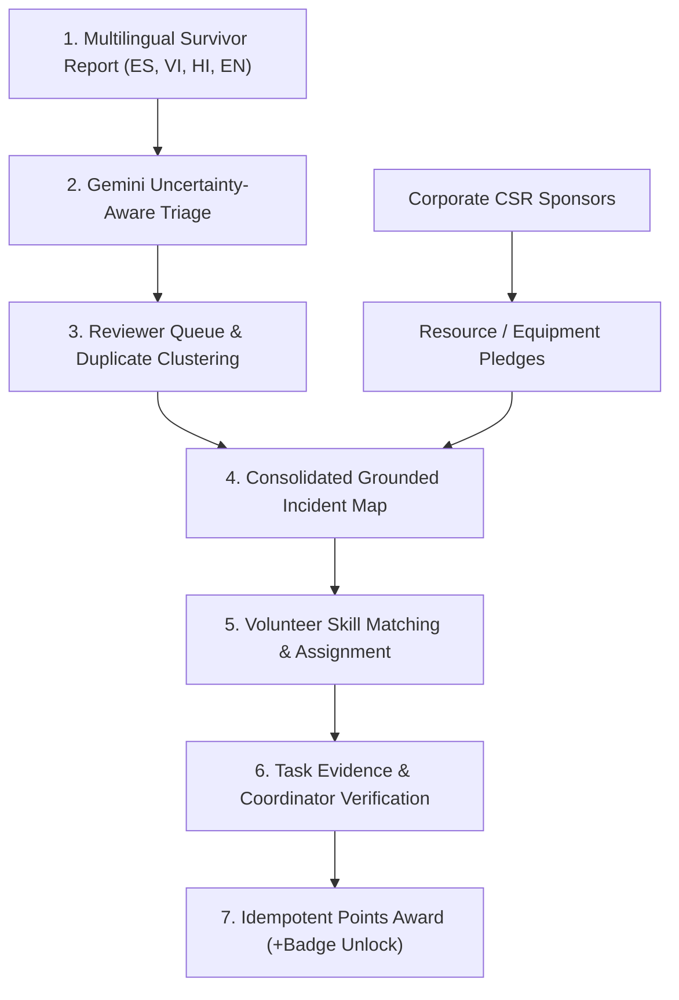

# AfterMath — AI-Powered Disaster Response & Volunteer Coordination Platform


> **AI Builder Cup Hackathon Implementation**  
> *A humanitarian-tech web application transforming chaotic, multilingual disaster reports into structured, human-verified incidents and connecting survivors with community volunteers and corporate relief resources.*

---

## 🚨 Official Emergency Disclaimer
**AfterMath is a community and humanitarian coordination platform; it is not a substitute for official municipal emergency services.**  
If you or anyone in your area is in immediate life danger, **call 911 / 112 or your local emergency dispatch immediately.**

---

## 🌟 Product Vision & The Uncertainty-Aware Differentiator

In catastrophic disasters, unstructured distress calls arrive across languages, channels, and fragmented locations. Common AI implementations hallucinate coordinates, invent casualty numbers, or bury vague life-safety emergencies behind low-confidence thresholds.

**AfterMath's core differentiator is strict Uncertainty Awareness:**
1. **Explicit Fact vs Inference Isolation:** Every AI triage output cleanly distinguishes survivor-reported facts from AI deductions and unverified missing data.
2. **Decoupled Urgency & Confidence:** If a report indicates drowning or hypothermia risk, urgency remains **CRITICAL** even if location or identity confidence is low. Ambiguous emergencies never disappear into a backlog.
3. **Zero Fabricated Coordinates:** Reports without verified coordinates are routed to a dedicated **Unlocated Queue** with uncertainty radius buffers, rather than hallucinating arbitrary pins on a map.
4. **Single Account, Multiple Capabilities:** Community members can request assistance and volunteer using the same account without needing separate administrative credentials.
5. **Decoupled Humanitarian Prioritization:** Emergency triage is calculated strictly on humanitarian vulnerability. Volunteer points or corporate sponsorship amounts never influence triage order.

---

## 🏗️ Google-First Tech Stack

| Layer | Technologies | Role / Rationale |
| :--- | :--- | :--- |
| **Frontend** | React 18, TypeScript, Vite, Tailwind CSS, Lucide Icons | Responsive humanitarian-grade SPA with sub-second HMR |
| **Routing & Forms** | React Router v6, React Hook Form, Zod runtime validation | Accessible form validation, role-guarded routes |
| **Backend & Persistence** | Cloud Firestore, Firebase Authentication, Cloud Storage | Real-time multi-collection synchronization |
| **AI Intelligence** | Google Gemini 1.5/2.5 Flash via Google AI API + Deterministic Mock | Multilingual structured extraction, uncertainty triage, duplicate scoring |
| **Geospatial & Maps** | Grounded coordinate mapping, uncertainty radius circles, unlocated drawer | Prevents GPS hallucination; provides mobile list view fallback |
| **Security & Audits** | Role-Based Access Control (RBAC), Append-Only Audit Trail | Client-side role escalation blocked; idempotent point rewards |
| **Testing** | Vitest, React Testing Library, JSDOM | Comprehensive test suites for all 6 core workflows (Tests A-F) |

---

## 🚀 Quick Start Guide

### Prerequisites
- Node.js `v20+` or `v22+`
- npm `v10+`

### 1. Installation
```powershell
# Navigate to the aftermath project directory
cd "C:\Users\DINESH KUMAR\.gemini\antigravity\scratch\aftermath"

# Install dependencies
npm.cmd install
```

### 2. Run the Development Server
```powershell
npm.cmd run dev
```
Open your browser at `http://localhost:5173`.

### 3. Run the Automated Test Suite (15/15 Tests)
```powershell
npm.cmd test
```

### 4. Build for Production
```powershell
npm.cmd run build
```

---

## 🎭 Persona Switching & Demonstration Scenarios

AfterMath includes a top navigation **Persona Selector** for instant evaluation across all 4 stakeholder tiers:

| Persona | Role | Preloaded Capabilities & Scenario |
| :--- | :--- | :--- |
| **Maria Santos** | `user` (Volunteer Opted-In) | Bilingual survivor in Cedar Valley. Can submit help requests, browse matched tasks, submit completion evidence, and view verified points (+85 pts). |
| **Elena Rostova** | `reviewer` (Lead Triage) | Authorized triage officer. Inspects incoming distress reports, corrects fields, merges duplicates, and signs off on incident grounding. |
| **Marcus Vance** | `coordinator` (Field Ops) | Field director. Dispatches boats, manages high school shelter logistics, approves volunteer evidence, and issues idempotent point awards. |
| **Apex Global CSR** | `corporate_partner` | Logistics enterprise. Pledges potable water flatbeds and satellite mesh kits; exports verified CSR impact CSV reports. Org-scoped data isolation enforced. |
| **System Admin** | `admin` | Full governance console, AI pipeline monitor, and one-click demo data reset. |

---

## 🔄 The 7-Stage Core Coordination Pipeline



---

## 🛡️ Security, Privacy & Integrity Controls

1. **Role Escalation Defense:** Client applications cannot modify `profiles.roles` or `volunteerProfiles.verifiedPoints`. Role grants are enforced via server-side rules.
2. **Idempotent Rewards Engine:** Contribution awards generate deterministic hash keys (`contrib_{userId}_{taskId}`). Attempting duplicate rewards returns an idempotency conflict.
3. **Data Scoping:** Corporate partner users are strictly scoped to their own organization ID and cannot view private survivor contact details or other companies' records.
4. **Append-Only Auditing:** Reviewer corrections, merges, and verifications append immutable audit entries with reviewer name and mandatory justification.

---

## ⚙️ Environment Variables Configuration

Create a `.env` file in the root directory:

```env
# Optional Live Gemini AI Key (When omitted, Deterministic Mock Engine runs automatically)
VITE_GEMINI_API_KEY=AIzaSy...

# Optional Google Maps API Key
VITE_GOOGLE_MAPS_API_KEY=AIzaSy...

# Optional Live Firebase Configuration
VITE_FIREBASE_API_KEY=AIzaSy...
VITE_FIREBASE_AUTH_DOMAIN=aftermath-disaster.firebaseapp.com
VITE_FIREBASE_PROJECT_ID=aftermath-disaster
VITE_FIREBASE_STORAGE_BUCKET=aftermath-disaster.appspot.com
VITE_FIREBASE_MESSAGING_SENDER_ID=100000000000
VITE_FIREBASE_APP_ID=1:100000000000:web:abcdef

# Firebase Emulator Support
VITE_USE_FIREBASE_EMULATOR=false
VITE_ENABLE_MOCK_AI=true
```

---

## 📂 Repository Directory Structure

```
aftermath/
├── public/
│   └── logo.jpg               # Concentric topographic wave contour brand logo
├── src/
│   ├── components/
│   │   ├── layout/            # Navbar with emergency banner & Footer
│   │   ├── map/               # Grounded IncidentMap & uncertainty radius
│   │   └── ui/                # Accessible UI primitives (Button, Card, Badges)
│   ├── context/
│   │   ├── AuthContext.tsx    # Single-account multi-capability & persona switch
│   │   └── DataContext.tsx    # Persistent collections, AI triage, idempotent awards
│   ├── lib/
│   │   ├── firebase.ts        # Firebase client & emulator config
│   │   ├── gemini.ts          # Uncertainty triage & deterministic mock engine
│   │   └── seedData.ts        # Repeatable synthetic flood-response dataset
│   ├── pages/
│   │   ├── LandingPage.tsx    # Public landing page with vision & metrics
│   │   ├── ReportHelpPage.tsx # Intake form with GPS detection & instant AI triage
│   │   ├── IncidentListPage.tsx # Interactive map & searchable incident registry
│   │   ├── IncidentDetailPage.tsx # Consolidated incident & associated reports
│   │   ├── ReviewQueuePage.tsx # Prioritized reviewer & triage console
│   │   ├── ReviewDetailPage.tsx # Review workbench & duplicate merge tools
│   │   ├── VolunteerHubPage.tsx # Single-account volunteer portal & matching
│   │   ├── TaskDetailPage.tsx # Task execution & coordinator signoff desk
│   │   ├── ImpactHubPage.tsx  # Verified points ledger & certificate download
│   │   ├── CorporatePortalPage.tsx # Enterprise CSR directory
│   │   ├── CorporateDashboardPage.tsx # Org-scoped pledge tracker & CSV export
│   │   ├── AdminPage.tsx      # System health & global audit stream
│   │   └── AuthPages.tsx      # Login, registration, and user dashboard
│   ├── tests/
│   │   ├── ai-triage.test.ts  # Module B test suite
│   │   ├── volunteer-workflow.test.ts # Module E & F test suite
│   │   ├── human-review.test.ts # Module C test suite
│   │   ├── corporate-workflow.test.ts # Module G test suite
│   │   └── user-journey.test.ts # User journey & RBAC test suite
│   ├── types/
│   │   └── index.ts           # Comprehensive TypeScript domain models
│   ├── App.tsx                # Master route router
│   ├── main.tsx               # DOM mount
│   └── index.css              # Custom styling, dark mode, glassmorphism
├── firestore.rules            # Security rules enforcing RBAC and immutability
├── firestore.indexes.json     # Composite query index definitions
├── storage.rules              # Storage rules with MIME & size restrictions
├── firebase.json              # Hosting and Emulator suite configuration
├── package.json               # Dependencies and scripts
├── tailwind.config.js         # Humanitarian emerald theme & palette
└── tsconfig.json              # TypeScript compilation settings
```

---

## 🏆 Definition of Done Verification

- [x] Responsive web application starts and builds cleanly (`npm.cmd run build` exit 0).
- [x] All 15 automated test suites pass (`npm.cmd test` exit 0).
- [x] Single account per person handles both assistance requests and volunteer tasks.
- [x] AI extraction with uncertainty awareness, fact vs inference separation, and zero coordinate fabrication.
- [x] Multilingual distress intake (Spanish, Vietnamese, Hindi, English) with translation preservation.
- [x] Reviewer workbench supports field correction, duplicate merging, and unmerging with append-only audit trail.
- [x] Grounded incident map with uncertainty radius halos and unlocated reports queue.
- [x] Idempotent volunteer point awards prevent duplicate claims.
- [x] Corporate partner dashboard with pledge tracking and organization-level data isolation.
- [x] Official emergency disclaimers prominent across all views.
- [x] Full demonstration scenario pre-seeded and resettable with one click.
